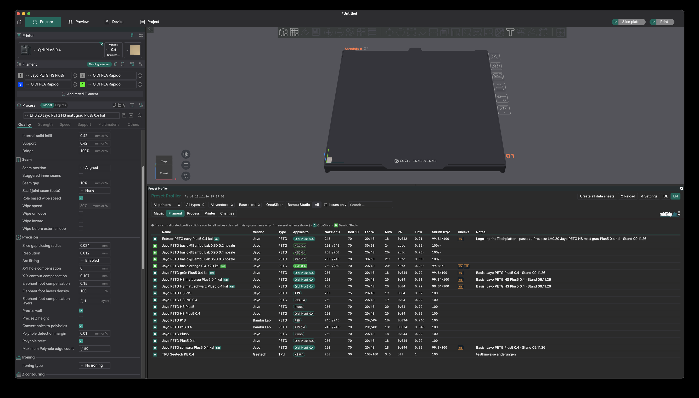
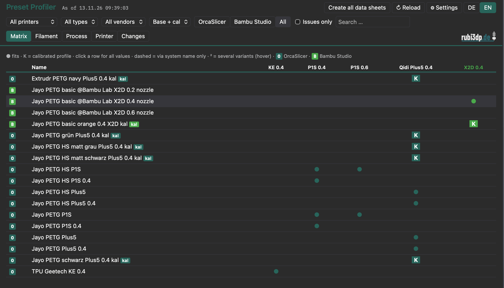
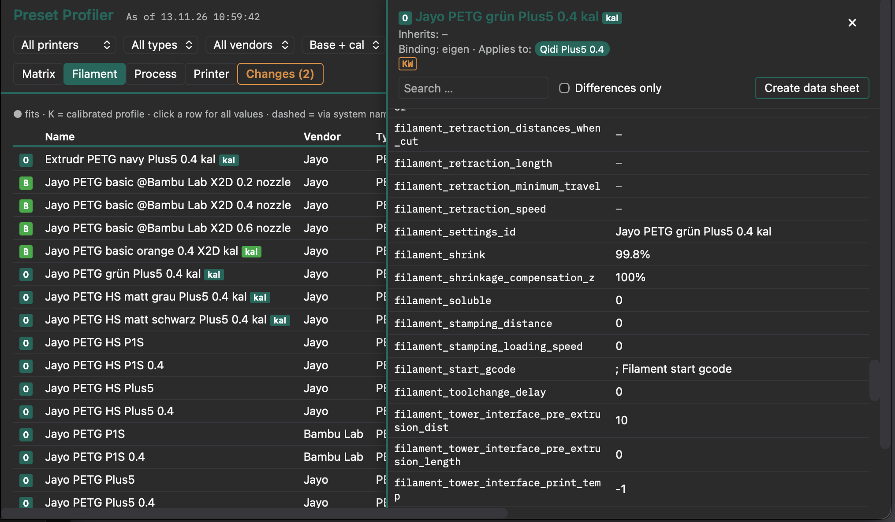
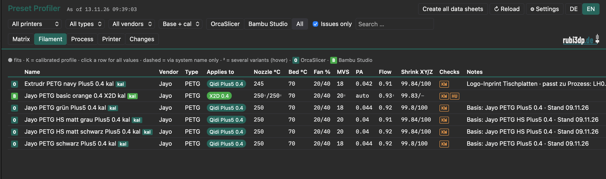
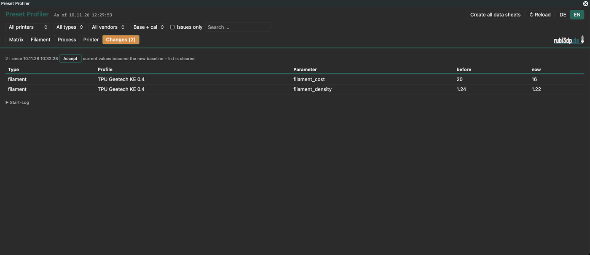
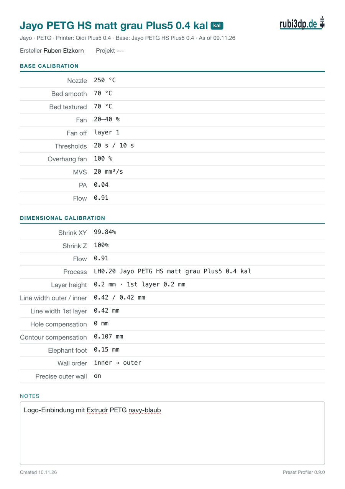

# Preset Profiler

**An OrcaSlicer plugin that shows all of your own printer, filament and process presets at a glance – with checks, change tracking and printable data sheets.**
Plugin für OrcaSlicer: Übersicht, Prüfungen und Datenblätter für die eigenen Profile – [deutsche Kurzfassung unten](#deutsch).

> Version 0.9.4 – pre-release. Tested on macOS. Windows and Linux testers welcome (see [Feedback](#feedback)).

## What it does

- **Overview** – all your own presets in one docked window inside Orca: which filament/process belongs to which printer, key values, differences to the parent preset.
- **Checks** – finds typical mistakes: empty or broken bindings, presets bound to deleted printers, assignments that hide a preset, names that don't match the binding, calibrated presets without correction values, unclear hotend variant.
- **Changes** – shows which values changed since your last accepted state, e.g. after a vendor/system profile update silently changed inherited values.
- **Data sheets** – one sheet per filament (base calibration + dimensional calibration), readable on a tablet, printable as A4/A5 or PDF, with a notes field.
- **Export** – CSV files and an HTML overview.
- **Bambu Studio** – optionally also reads your own Bambu Studio presets (read-only, marked B in Bambu green).

**Read-only.** The plugin never changes presets, never goes online and only writes to folders you choose. It is not a preset editor – keep editing in Orca; Preset Profiler is for getting your preset data out quickly and keeping track of it.

## Screenshots

**Matrix** – which filament fits which printer, K = calibrated preset

**Details** – click a row for all values; ² marks values per hotend variant (e.g. Standard / High Flow)

**Checks** – "Issues only" filters presets with findings

**Changes** – values that changed since the last accepted state

**Data sheet** – base + dimensional calibration, printable or as PDF

## Install

**Orca Cloud:** in OrcaSlicer 2.5+ open **Plugins › Install plugin**, search for *Preset Profiler* and subscribe – updates come automatically.

**Manual:**

1. Download `preset_profiler.py` from the [latest release](../../releases/latest).
2. In OrcaSlicer 2.5+: **Plugins › Install local plugin** and select the file.
3. Restart Orca, then run **Plugins › Preset Profiler – Settings** to set folders and options.
4. After setting a folder, restart Orca once more and confirm the folder access prompt.

Full guide: [English](docs/guide-en.md) · [Deutsch](docs/anleitung-de.md)

## Feedback

Bug reports and test results (especially Windows/Linux) are very welcome – please open an [issue](../../issues) with your OS, Orca version and what happened.

## License

GPL-3.0 – see [LICENSE](LICENSE). © Ruben Etzkorn · rubi3dp

---

## Deutsch

**Preset Profiler** zeigt alle eigenen Drucker-, Filament- und Prozessprofile übersichtlich in einem Fenster in Orca – mit Prüfungen auf typische Fehler, einer Liste der Änderungen (z. B. nach Updates der Systemprofile), Datenblättern je Filament und CSV/HTML-Export. Das Plugin liest nur, ändert keine Profile und geht nicht ins Internet.

Installation: `preset_profiler.py` herunterladen, in OrcaSlicer 2.5+ über **Plugins › Install local plugin** installieren, Orca neu starten, unter **Preset Profiler – Einstellungen** Ordner festlegen, Orca erneut starten und die Ordner-Abfrage bestätigen.

Ausführliche Anleitung: [docs/anleitung-de.md](docs/anleitung-de.md)

Version 0.9.0 (Vorabversion), getestet auf macOS. Rückmeldungen gern als [Issue](../../issues).
